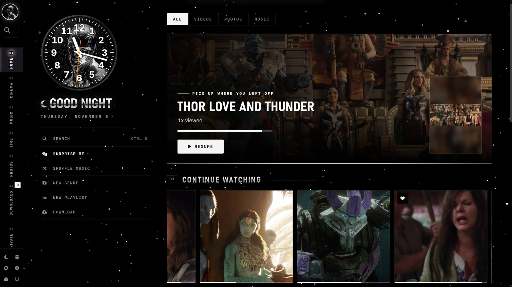
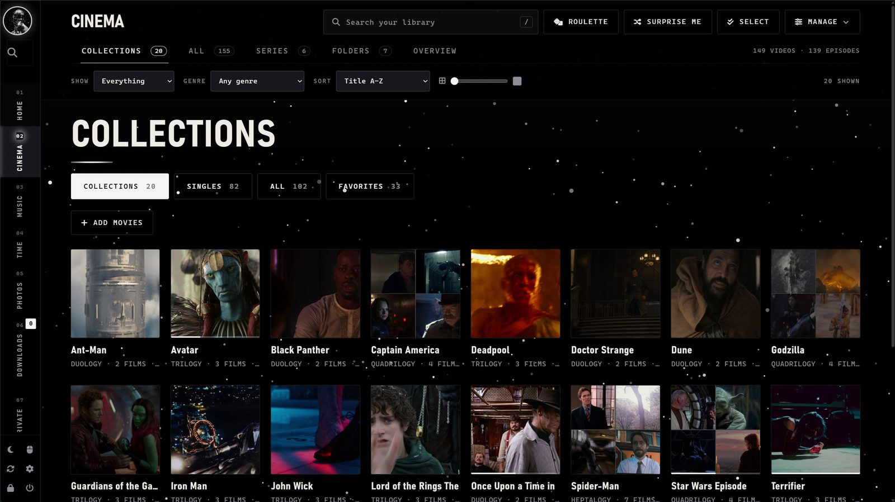
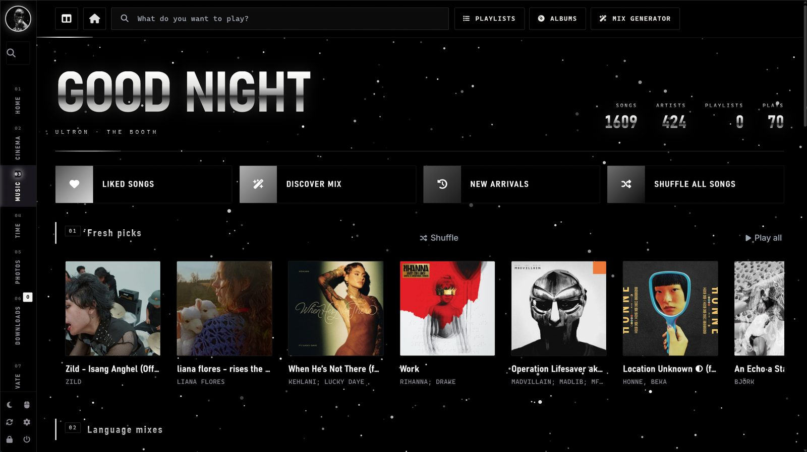
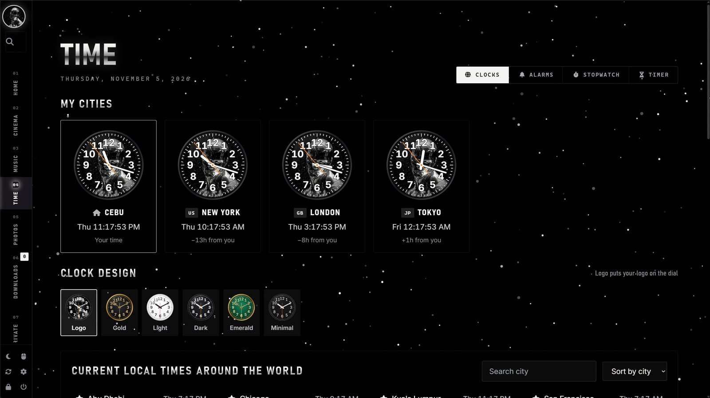
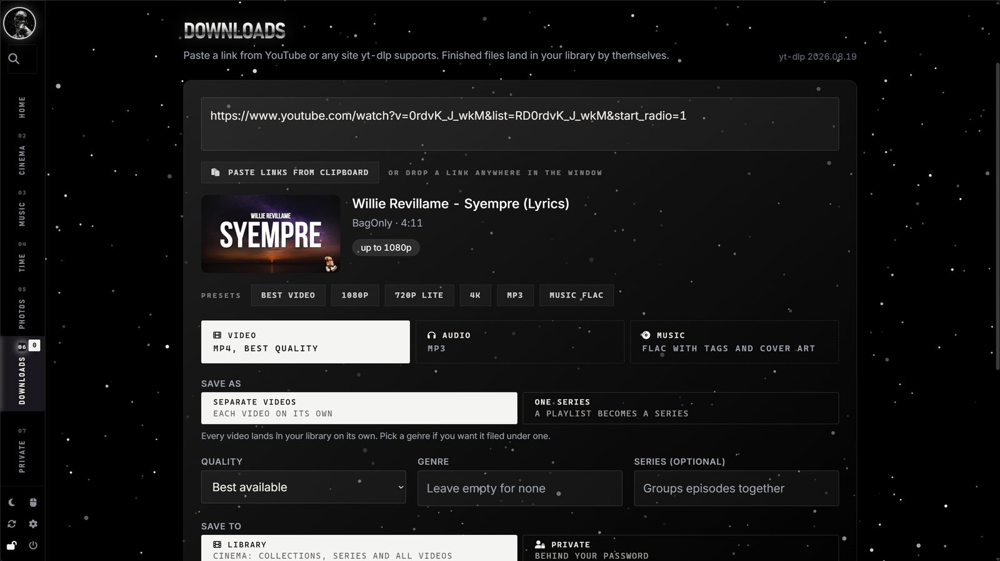
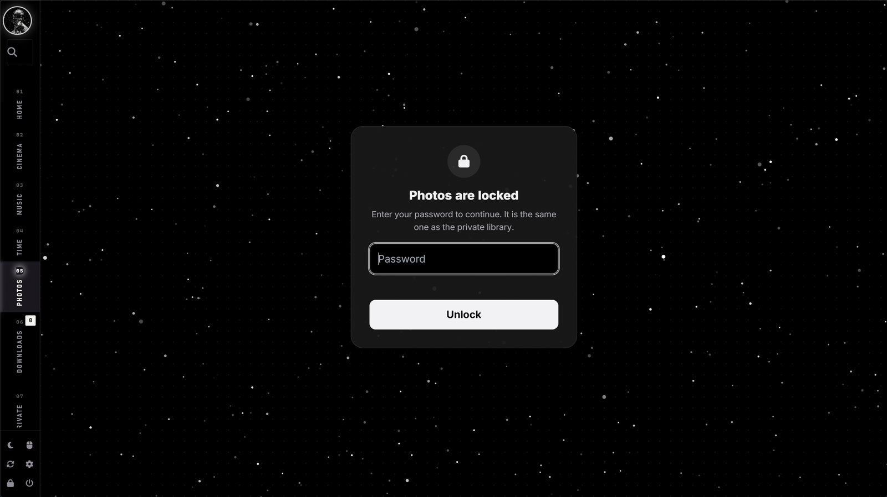

# Local Media Player (ZENO / ULTRON)

A desktop player for your **own** videos, music and photos. A Flask backend serves a single-page
frontend inside a native window (pywebview), with a native libmpv player for formats browsers can't play.
Everything runs locally and works **offline**: Tailwind CSS, Font Awesome and the Inter font are bundled in `vendor/`.

## Features

- **Cinema**: movies, series and auto-detected collections (duologies, trilogies...) as square tiles, favorites, ratings, resume where you left off
- **Music**: library, artists, albums you make yourself, playlists, mixes, audio-reactive visuals, DJ deck
- **Photos** and a password-protected **private library** with its own search
- **Smart genres**: looks up genres once (TMDB / MusicBrainz / Last.fm), then works offline
- **Auto subtitles** (faster-whisper), clip trimmer, **Downloader** (yt-dlp)
- **Backup / restore**, weekly auto-backup, your data survives new versions
- Disk-friendly: low-priority background work, so it plays nicely with torrent clients

## Screenshots

| Home | Cinema |
|---|---|
|  |  |

| Music | Time |
|---|---|
|  |  |

| Downloads | Photos lock |
|---|---|
|  |  |

## Requirements

- Windows 10/11 (64-bit) and Python 3.12
- `libmpv-2.dll`, `ffmpeg`/`ffprobe`, and optionally `yt-dlp` and the subtitle models, see [SETUP.txt](SETUP.txt)

## Run

```bash
pip install -r requirements.txt
python app.py
```

Useful flags:

```bash
python app.py --browser                              # debug in your browser
python app.py --videos "D:\Videos" --music "E:\Music"  # custom folders
```

## Build the .exe

Run `build_exe.bat` (needs Python on PATH).

## Notes

- Your data lives in `%APPDATA%\ZENO\data` and is never part of this repo.
- Full list of changes: [CHANGELOG.md](CHANGELOG.md). Dev notes: [TODO.md](TODO.md).
